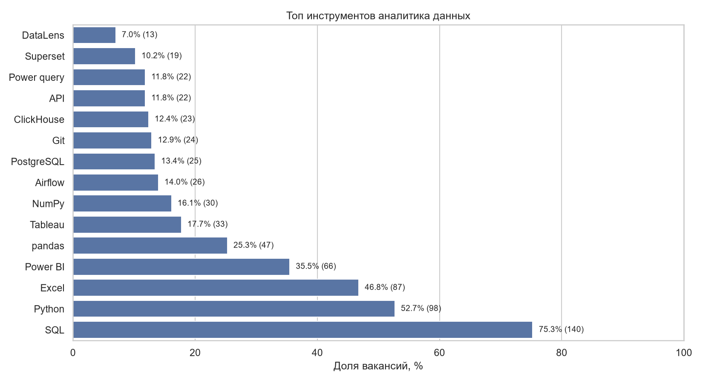
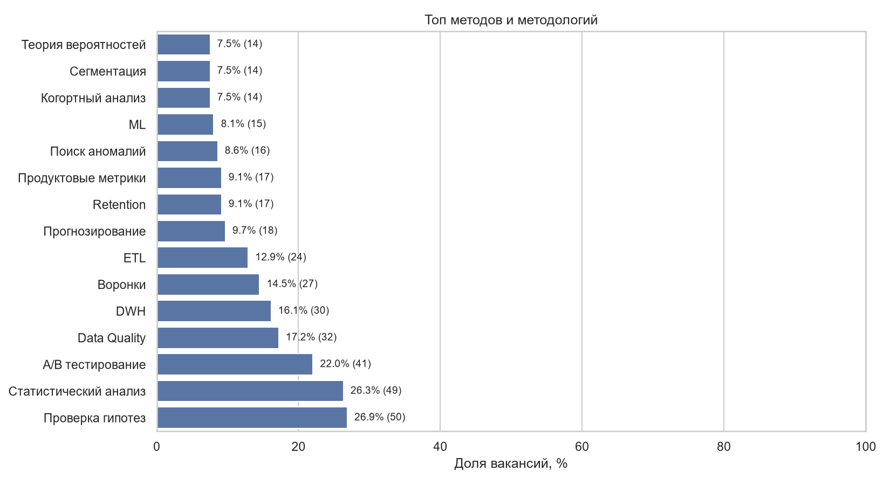
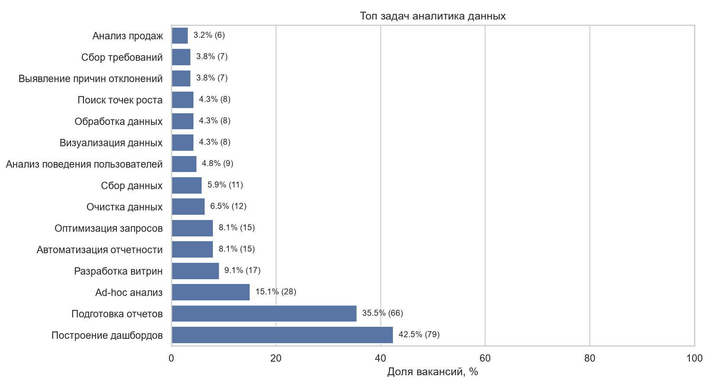

# Анализ рынка вакансий аналитика данных: парсинг → NLP → рекомендации

## О проекте

End-to-end проект по анализу рынка труда в сфере аналитики данных. Скрипт автоматически собирает вакансии с hh.ru, извлекает требования с помощью LLM, ранжирует навыки по частотности и формирует рекомендации по пет-проектам, которые максимально соответствуют реальным запросам работодателей.

Проект демонстрирует полный цикл работы с данными: от сбора сырых данных до бизнес-рекомендаций.

## Бизнес-ценность

**Проблема:** Начинающие аналитики тратят время на нерелевантные пет-проекты, не понимая, какие навыки действительно востребованы на рынке.

**Решение:** Автоматизированный анализ вакансий, который показывает:
- Топ-10 инструментов
- Топ-10 методов
- Топ-10 задач
- Ранжированный список пет-проектов по покрытию требований

**Результат:** Чёткое понимание, какие навыки развивать в первую очередь, и конкретные идеи проектов, которые закроют 60-80% требований рынка.

## Ключевые результаты

- Собрано и проанализировано **186 вакансий** за последние 15 дней с hh.ru
- Извлечено **2345 уникальных требований** (инструменты, методы, задачи)
- Построено **6 идей пет-проектов** с оценкой покрытия рынка
- Топ-3 проекта закрывают **70-85% требований** работодателей
- Полностью автоматизированный пайплайн: от парсинга до Excel-отчёта

## Стек технологий

**Сбор данных:**
- Playwright (обход блокировок, парсинг динамических страниц)
- requests, BeautifulSoup (HTTP-запросы, HTML-парсинг)

**Обработка и анализ:**
- Python 3.13, pandas, NumPy
- Регулярные выражения, NLP-подходы (нормализация, кластеризация)
- OpenRouter API (бесплатная LLM для извлечения требований)

**Визуализация и отчётность:**
- matplotlib, seaborn (графики)
- openpyxl (Excel-отчёты)
- Markdown (документация)

**Инженерия данных:**
- Чекпоинты и возобновление после сбоев
- Кэширование LLM-вызовов
- Дедупликация данных
- Автоматизация пайплайна

## Какие навыки демонстрирует проект:

**Работа с данными:**
- Парсинг веб-страниц и обход анти-бот систем
- Извлечение структурированных данных из неструктурированного текста
- Очистка и нормализация данных (стоп-слова, лемматизация, дедупликация)
- Частотный анализ и ранжирование

**Программирование:**
- Python (pandas, requests, BeautifulSoup, matplotlib, seaborn)
- Работа с API (REST, JSON, авторизация)
- Регулярные выражения
- Автоматизация скриптов

**Инженерия данных:**
- Построение ETL-подобного пайплайна
- Обработка ошибок и отказоустойчивость
- Кэширование и оптимизация запросов
- Модульная архитектура (6 этапов)

**Визуализация:**
- Построение горизонтальных bar charts
- Экспорт в Excel с несколькими листами
- Генерация markdown-отчётов

## Структура проекта

```
hh_parser/
├── config.py                      # настройки и фильтры
├── stage1_collect_links.py        # сбор ссылок с hh.ru
├── stage2_parse_vacancies.py      # парсинг карточек вакансий
├── stage3_prepare_text.py         # очистка текста и разбиение на блоки
├── stage4_extract_requirements.py # извлечение требований (словарь + LLM)
├── stage5_normalize_rankings.py   # нормализация и кластеризация задач
├── stage6_report_and_projects.py  # визуализация и идеи пет-проектов
├── run_all.py                     # главный файл запуска
└── results/                       # итоговые файлы
    ├── top_tools.png              # визуализация инструментов
    ├── top_methods.png            # визуализация методов
    ├── top_tasks.png              # визуализация задач
    ├── report.xlsx         # Excel-отчёт
    ├── report.md           # markdown-отчёт c визуализацией
    ├── pet_projects_ranked.csv    # рейтинг пет-проектов
    └── top_all.csv                # топ-30 требований
```

## Примеры результатов

### Топ-10 инструментов




- SQL: 75.27% (140)
- Python: 52.69% (98)
- Excel: 46.77% (87)
- Power BI: 35.48% (66)
- pandas: 25.27% (47)
- Tableau: 17.74% (33)
- NumPy: 16.13% (30)
- Airflow: 13.98% (26)
- PostgreSQL: 13.44% (25)
- Git: 12.9% (24)

### Топ-10 методов



- Проверка гипотез: 26.88% (50)
- Статистический анализ: 26.34% (49)
- A/B тестирование: 22.04% (41)
- Data Quality: 17.2% (32)
- DWH: 16.13% (30)
- Воронки: 14.52% (27)
- ETL: 12.9% (24)
- Прогнозирование: 9.68% (18)
- Retention: 9.14% (17)
- Продуктовые метрики: 9.14% (17)

### Топ-10 задач



- Построение дашбордов: 42.47% (79)
- Подготовка отчетов: 35.48% (66)
- Ad-hoc анализ: 15.05% (28)
- Разработка витрин: 9.14% (17)
- Автоматизация отчетности: 8.06% (15)
- Оптимизация запросов: 8.06% (15)
- Очистка данных: 6.45% (12)
- Сбор данных: 5.91% (11)
- Анализ поведения пользователей: 4.84% (9)
- Визуализация данных: 4.3% (8)

### Топ-3 пет-проекта (по покрытию рынка)
1. **Продуктовый дашборд маркетплейса с A/B тестами** — score 320, закрывает 15 требований
2. **Когортный анализ и retention для подписочного сервиса** — score 250, закрывает 12 требований
3. **Поиск аномалий в финансовых транзакциях (финтех)** - Score: 284.4, закрывает 15 требований.

## Как запустить

```bash
# Установка зависимостей
pip install -r requirements.txt
playwright install chromium

# Настройка API-ключа OpenRouter
setx OPENROUTER_API_KEY "sk-or-v1-..."

# Запуск пайплайна
python run_all.py
```

Подробная инструкция по запуску в [INSTRUCTIONS.md](INSTRUCTIONS.md).
