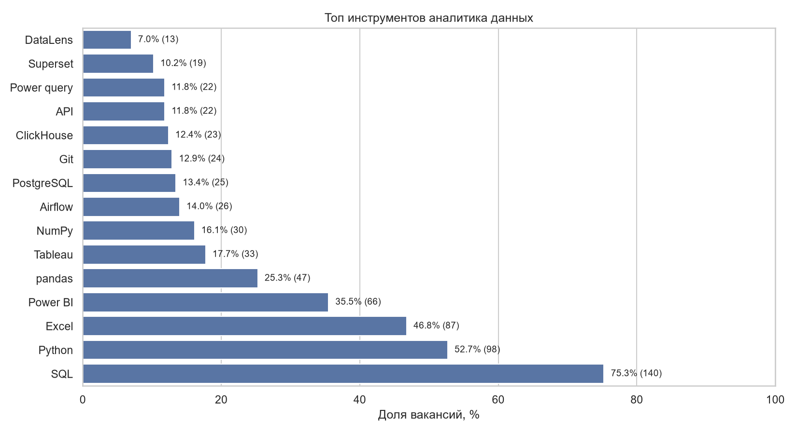
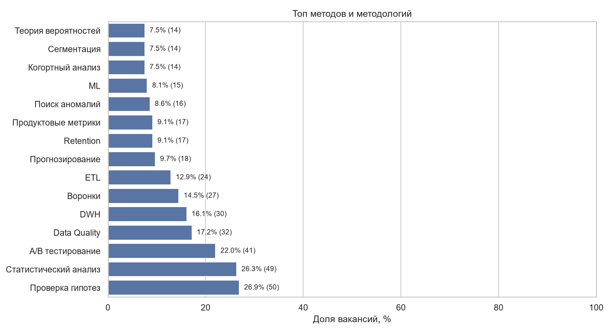
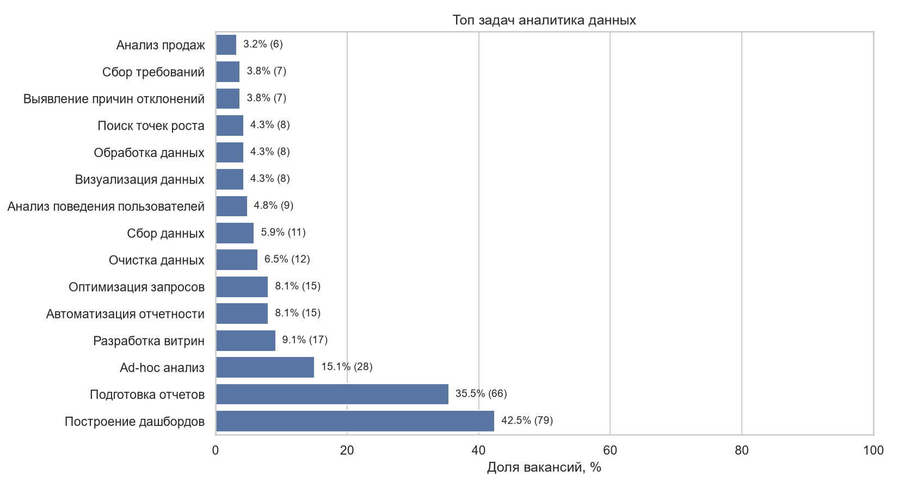

# Анализ требований вакансий аналитика данных

Дата: 2026-11-16 01:04
Вакансий в выборке: 186

## Топ инструментов

- SQL: 75.27% (140)
- Python: 52.69% (98)
- Excel: 46.77% (87)
- Power BI: 35.48% (66)
- pandas: 25.27% (47)
- Tableau: 17.74% (33)
- NumPy: 16.13% (30)
- Airflow: 13.98% (26)
- PostgreSQL: 13.44% (25)
- Git: 12.9% (24)

## Топ методов

- Проверка гипотез: 26.88% (50)
- Статистический анализ: 26.34% (49)
- A/B тестирование: 22.04% (41)
- Data Quality: 17.2% (32)
- DWH: 16.13% (30)
- Воронки: 14.52% (27)
- ETL: 12.9% (24)
- Прогнозирование: 9.68% (18)
- Retention: 9.14% (17)
- Продуктовые метрики: 9.14% (17)

## Топ задач

- Построение дашбордов: 42.47% (79)
- Подготовка отчетов: 35.48% (66)
- Ad-hoc анализ: 15.05% (28)
- Разработка витрин: 9.14% (17)
- Автоматизация отчетности: 8.06% (15)
- Оптимизация запросов: 8.06% (15)
- Очистка данных: 6.45% (12)
- Сбор данных: 5.91% (11)
- Анализ поведения пользователей: 4.84% (9)
- Визуализация данных: 4.3% (8)

## Рекомендуемые пет-проекты (по покрытию требований)

### 1. Продуктовый дашборд маркетплейса с A/B тестами
Score покрытия: 423.11 | закрыто требований: 18

Дашборд продуктовых метрик (воронки, retention, когорты) на данных маркетплейса + модуль проведения и оценки A/B тестов.

Стек: SQL, Python, Power BI, pandas, PostgreSQL, Git
Артефакты: SQL-витрины в PostgreSQL; Python-скрипт расчёта метрик и A/B; Дашборд Power BI; README с методологией и выводами

### 2. Когортный анализ и retention для подписочного сервиса
Score покрытия: 332.8 | закрыто требований: 16

Когортный анализ, RFM-сегментация, расчёт LTV/CAC/retention/churn и рекомендации по удержанию.

Стек: SQL, Python, pandas, Power BI, Excel
Артефакты: Ноутбук с когортами и RFM; Дашборд retention/LTV; Презентация с рекомендациями

### 3. Поиск аномалий в финансовых транзакциях (финтех)
Score покрытия: 284.4 | закрыто требований: 15

Система мониторинга транзакций: статистические правила и ML-модель для поиска аномалий, алерты и дашборд расследований.

Стек: SQL, Python, pandas, scikit-learn, ClickHouse, PostgreSQL
Артефакты: Ноутбук с baseline и моделью; Скрипт инференса и алертов; Дашборд аномалий; Отчёт о precision/recall

## Что доизучить (топ-требования вне лучшего проекта)

- Data Quality (method): 17.2%
- DWH (method): 16.13%
- ETL (method): 12.9%
- Прогнозирование (method): 9.68%
- Retention (method): 9.14%
- Поиск аномалий (method): 8.6%
- ML (method): 8.06%
- Теория вероятностей (method): 7.53%
- LTV (method): 6.99%
- Регрессионный анализ (method): 4.3%